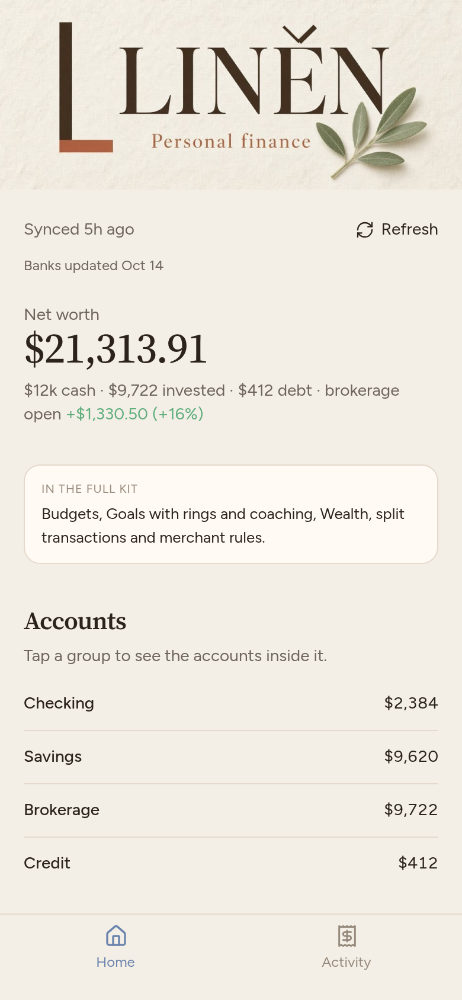

# Put Liněn on your phone

Liněn works like a regular app once it's on your home screen: its own icon, full screen, no browser bars. You don't need an app store.

*What you'll see once it's open (demo data).*

Before you start, have your Liněn web address handy (from wherever you deployed it).

---

## iPhone (use Safari)

1. Open **Safari**. (Safari works best for this on iPhone.)
2. Type your Liněn web address and open it.
3. Tap the **Share** button. It looks like a square with an arrow pointing up (⬆︎ in a box). On iPhone it's in the bar at the bottom of the screen; if you don't see the bar, scroll up a little. On iPad it's at the top.

4. A menu slides up. Scroll down the list and tap **Add to Home Screen** (it has a ➕ in a square next to it).

5. Check the name (it should say **Liněn**; you can change it), then tap **Add** in the top-right corner.

6. Find the Liněn icon on your home screen and tap it. It opens full screen, like any other app.

**If the icon looks blank or the name is wrong:** delete the icon (press and hold it, then Remove App > Delete from Home Screen), close Safari completely, open the address again, and repeat the steps.

---

## Android (use Chrome)

1. Open **Chrome**.
2. Type your Liněn web address and open it.
3. Tap the **menu** button: three dots stacked on top of each other ( ⋮ ), in the top-right corner.

4. Tap **Install app**. (On some phones it says **Add to Home screen**.)

5. Tap **Install** (or **Add**) to confirm.

6. Open Liněn from your home screen or app drawer.

---

## Good to know
- **Updates show up on their own.** When your assistant updates the app, just close and reopen it.
- **Your settings live on your phone.** Settings are saved on the phone you use. If you switch phones, set them up again.
- **Private site?** If you turned on Cloudflare Access, you'll be asked to confirm your email the first time you open the app. That's expected.
