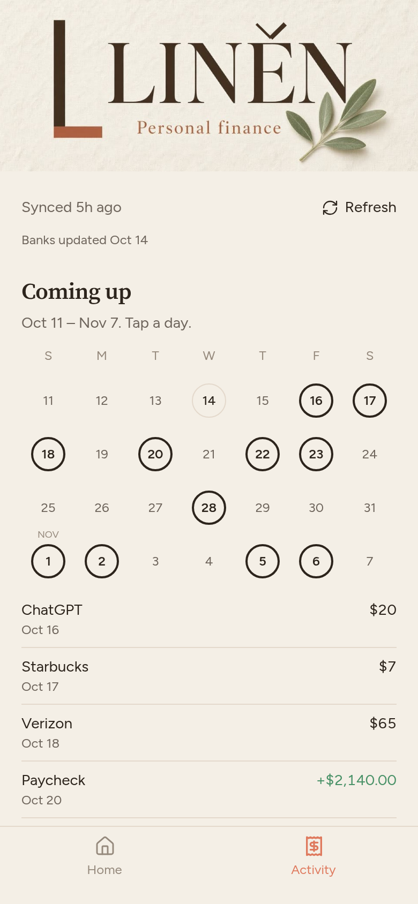

# Liněn sample: a calm money app you run yourself

This is the **free sample** of Liněn, a phone-first personal-finance app. It includes the app shell, the theme (palette, fonts, header), the **Home** and **Activity** screens, and fictional demo data.

<p>


</p>

**The full Liněn kit** adds Budgets, Goals (rings, what-if dates, coaching notes), Wealth, split transactions, merchant rules with undo, a one-prompt setup guide, and fixes for 90 days: **[link to the full kit]**

**Built with Grok, not affiliated with xAI.**
**Not financial advice.** Liněn is an educational tool, not a licensed financial adviser.

## Quick start

```bash
npm install
npm run dev          # http://localhost:8080
npm test
npm run build        # Node server in .output/
npm run build:cloudflare   # Cloudflare Pages output in dist/
```

The demo data comes from `scripts/generate-demo.mjs` (`npm run demo:generate`). It's a fictional person with fictional accounts. To put it on your phone, see **PHONE.md**.

## License

MIT for this sample. The full kit has its own license.
